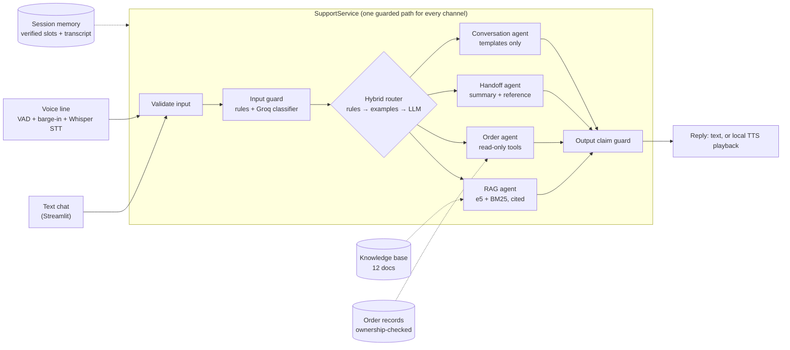

# Agentic Customer Support Assistant

A customer support assistant for **Northstar Gear**, a fictional travel-backpack
brand, that works over text chat and a phone-style voice line. It routes each
message to the right agent, grounds product answers in a small knowledge base,
reads orders through read-only tools, and enforces its safety rules in
application code rather than in prompts. Groq provides the LLM and Whisper
speech-to-text; everything else runs locally.

Every number in this README comes from a committed report and can be
reproduced with the commands below.

## Results

Measured on held-out sets that were never used for tuning. Live runs used Groq
`openai/gpt-oss-20b`.

| Measure | Result | Evidence |
|---|---:|---|
| Routing accuracy, live (110 held-out messages) | **95.5%** | `reports/phase2-hybrid-live-low-effort-evaluation.md` |
| Outcome the customer sees (no route answered as "unclear") | **99.1%** | same |
| Messages sent to a human that did not need one | **0** | same |
| Routing latency p50 / p95 | **14 ms / 0.70 s** | same |
| LLM calls per message for routing | **0.245** | same |
| Answerable product questions answered, live (32) | **93.8%** | `reports/final-rag-live-evaluation.md` |
| Unanswerable near-miss questions declined, live (13) | **13 of 13** | same |
| Expected evidence reaching the answerer | **0.922** | `reports/final-retrieval-offline-evaluation.md` |
| Voice: end of speech to playback start, speech turns | **2.1–2.9 s** | `recordings/final-*-run.json` |
| Voice: barge-in cancel after confirmed speech | **114–127 ms** | same |
| Keyless test suite | **221 passed**, 2 live skipped, 1 known-limit xfail | `python -m pytest` |

How each design choice was evaluated, including approaches that were tried
and dropped, is in [docs/evaluation.md](docs/evaluation.md) and
[docs/decisions-log.md](docs/decisions-log.md).

## Architecture



Detailed diagrams (architecture, request flow, memory across voice and text,
hybrid routing, voice barge-in) are in [docs/diagrams/](docs/diagrams/README.md).

- **Nothing reaches the router or an agent before the input guard allows it.**
  Unrouted or unclear messages go to an agent with no retrieval and no tools.
- **Hybrid routing.** Deterministic rules decide the clear cases, a
  nearest-example classifier decides confident paraphrases, and the Groq LLM
  handles the rest. In the live run the tiers decided 54, 29, and 27 of 110
  messages. See [docs/router-design.md](docs/router-design.md).
- **Grounded answers.** Retrieval fuses multilingual embeddings with BM25 and
  is tuned for recall; the answerer must decline when the passages do not
  answer, and the output guard blocks any date, amount, order ID, or promise
  that no tool or citation confirmed. See
  [docs/retrieval-design.md](docs/retrieval-design.md).
- **Tools stay in code.** Groq native function calling chooses one read-only
  tool; the application validates the order ID and checks ownership against
  the server-side session. Cancel and refund requests get an honest "I can't
  do that in chat" with the verified facts and a route to a human.
- **Memory with two trust levels.** Verified slots (active order, active
  product) are the only memory an LLM sees; the full transcript feeds the
  human handoff summary and is never put in a prompt. See
  [docs/memory-handling.md](docs/memory-handling.md).
- **Voice line.** WebRTC VAD proposes speech, Silero confirms it, the turn
  coordinator cancels playback and discards stale results, and STT failures
  retry once before a spoken safe handoff. See
  [docs/voice-coordination.md](docs/voice-coordination.md).

## Quick start

Requires Python 3.11 or newer; developed and tested on Windows 11 with
Python 3.14. Voice playback and TTS use built-in Windows audio and speech.

```powershell
py -m venv .venv
.\.venv\Scripts\Activate.ps1
python -m pip install --upgrade pip
python -m pip install -e ".[dev,demo]"

# Keyless test suite (fake providers; no Groq key needed)
python -m pytest
```

The first run downloads two small public models to the local Hugging Face
cache: `sentence-transformers/all-MiniLM-L6-v2` (routing examples) and
`intfloat/multilingual-e5-small` (retrieval).

To use the live service, put your Groq key in a local `.env` (see
[Configuration](#configuration)), then start the demo UI:

```powershell
python -m streamlit run scripts/streamlit_app.py --server.address 127.0.0.1 --server.port 8502
```

Open `http://127.0.0.1:8502`, pick a demo customer in the sidebar, and type,
or tap the microphone inside the message box and press Enter to send a
recording. Each reply shows which path answered it; trace details, the
handoff summary, and thumbs feedback are in the UI.

## Configuration

Copy `.env.example` to `.env` (ignored by Git) and fill in your values. Never
put a real key in source, docs, logs, chat, or recordings.

| Variable | Purpose | Default |
|---|---|---|
| `GROQ_API_KEY` | Groq key for live LLM and STT calls | none (tests run without it) |
| `GROQ_API_KEYS` or any `GROQ_<NAME>_KEY` | Extra keys; a rate-limited key is skipped for the next one | none |
| `GROQ_ROUTER_MODEL` | Model for guard, router, answers, tool choice | `openai/gpt-oss-20b` |
| `GROQ_ROUTER_REASONING_EFFORT` | Router reasoning effort (measured: same accuracy, lower latency) | `low` |
| `GROQ_TIMEOUT_SECONDS` | Per-request timeout | `15` |
| `ROUTER_MAX_ATTEMPTS` | Classifier attempts; only transient errors are retried | `2` |
| `LOG_LEVEL`, `LOG_FORMAT` | Logging level and `json` or `text` | `INFO`, `json` |

Configuration output reports only whether keys are configured and how many,
never their values.

## Reproduce the evidence

| What | Command | Needs Groq |
|---|---|---|
| Keyless tests | `python -m pytest` | no |
| Routing (local tiers only), retrieval, guardrails, cache | `python scripts/run_evaluation.py --label latest` | no |
| Live routing on the 110-message set | `python scripts/run_evaluation.py --label live --sections routing --routing-mode live --live-delay 3` | yes |
| Live end-to-end product answers (45 questions) | `python scripts/run_evaluation.py --label rag-live --sections rag --live-delay 3` | yes |
| Retriever comparison (9 configurations) | `python scripts/compare_retrievers.py` | no |
| Semantic-router threshold calibration | `python scripts/calibrate_semantic_router.py` | no |
| Voice scenarios with real recordings (plays audio) | `python scripts/run_voice_coordination.py <scenario> --evidence-prefix final` | yes |
| Drive the real UI headlessly | `python scripts/run_ui_check.py` | yes |
| Red-team probes | `python scripts/run_red_team.py` | yes |
| Audio manifest check | `python scripts/validate_audio_manifest.py` | no |
| Secret scan (prints paths and counts only) | `python scripts/scan_secrets.py` | no |
| Rebuild the presentation | `python scripts/build_presentation.py` | no |
| Re-render the diagrams (Docker) | `python scripts/render_diagrams.py` | no |

Voice scenarios: `silence`, `noise`, `normal_speech`, `return_eligibility`,
`interruption`, `adversarial`, `provider_failure`. On Windows, set
`$env:PYTHONIOENCODING = "utf-8"` before the live scripts that print model
text. The full walkthrough is in [docs/demo-runbook.md](docs/demo-runbook.md).

## Repository layout

```text
src/agentic_support/   SupportService pipeline, guards, routing tiers, agents, tools, memory, voice
scripts/               evaluation, calibration, voice scenarios, UI, red team, deck builder
tests/                 keyless pytest suite (live checks are opt-in)
evals/                 held-out and dev sets for routing, retrieval, and guardrails
knowledge_base/        12 Northstar Gear documents (fictional)
audio/                 user-recorded test clips and manifest
recordings/            voice run evidence (step7-*, step8-* history; final-* current)
reports/               evaluation reports, phase by phase
docs/                  design notes, Part C answers, decisions log, red-team report
presentation/          generated slide deck
```

## Deliverables

| Deliverable | Location |
|---|---|
| Presentation | [presentation/agentic-customer-support.pptx](presentation/agentic-customer-support.pptx), built by `scripts/build_presentation.py`; presenter notes and slide sources in [docs/presentation-speaker-notes.md](docs/presentation-speaker-notes.md) |
| Design notes (Parts A and B) | [docs/design-notes.md](docs/design-notes.md) |
| Architecture and flow diagrams | [docs/diagrams/](docs/diagrams/README.md) (SVG, PNG, and Mermaid source) |
| Part C answers | [docs/part-c-answers.md](docs/part-c-answers.md) |
| Voice demo evidence | [recordings/](recordings/), [docs/voice-coordination.md](docs/voice-coordination.md) |
| Decisions log | [docs/decisions-log.md](docs/decisions-log.md) |
| Red-team report | [docs/red-team-report.md](docs/red-team-report.md) |
| Requirements status | [docs/requirements-matrix.md](docs/requirements-matrix.md) |
| Live-defense notes | [docs/live-defense-notes.md](docs/live-defense-notes.md) |

## Known limitations

Stated rather than hidden; each is explained in the linked documents.

- Session memory is process-local. A restart or a second worker loses it;
  production needs a durable shared store.
- There is no second LLM provider. Key rotation and bounded rate-limit waits
  are implemented; provider failover is designed only.
- Voice latency is measured to application playback start, not to the first
  audible sample, with one run per scenario. One earlier run of the
  adversarial scenario took 3.02 s, so the 3-second target is met with a thin
  margin. Speech input is replayed from recordings, not a live microphone.
- The output claim guard uses patterns and does not understand negation: it
  blocks a correct "does not mean your refund is approved" (fails safe; pinned
  by a strict xfail test).
- A policy question phrased as "my refund" can be routed to the order agent,
  and a request for a human combined with a plain status question is answered
  without a handoff.
- A romanized-Hindi question can be answered in Devanagari script, which the
  English Windows TTS voice cannot read.
- The evaluation sets are small and written by the project author; one
  optional pace/accent recording is still pending.

## How this was built

The work is in incremental commits, one per reviewed and measured step, with a
timestamped [decisions log](docs/decisions-log.md) that records choices,
abandoned approaches (cross-encoder rerankers, running the guard and router in
parallel), and corrections to earlier claims. AI coding assistants were used,
as the assignment allows; log entries are labeled by author (`[USER]`,
`[CODEX]`, `[CLAUDE]`). Red-team findings come only from reproduced behavior,
and live results are always labeled as live. All customer data, orders, and
policies are fictional.

## Logging and debugging

Logs are one JSON event per line with a UTC timestamp, level, `trace_id`,
event name, and structured fields; secrets and token shapes are redacted
before formatting. The UI sidebar lists each turn's trace ID. To debug a turn: rerun
the smallest command with `LOG_LEVEL=DEBUG`, filter by its trace ID, compare
the event sequence with the expected path (`route_selected` shows which
routing tier decided), and add a failing test before changing code. Set
`LOG_FORMAT=text` for human-readable local output.

## Security

- `.env` and secret-like files are ignored by Git; `.env.example` stays blank.
- Default tests use fake providers and no key.
- Provider errors are logged by class, HTTP status, and provider code only,
  never with message text or key values.
- No real customer data is used anywhere in the repository.
